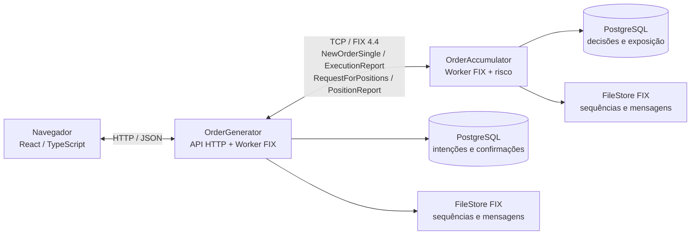

# OrderFlow

Aplicação de demonstração para envio de ordens e controle de exposição financeira, desenvolvida a partir de um desafio técnico da Flowa.

O **OrderGenerator** recebe ordens de uma interface web e as envia ao **OrderAccumulator** usando **QuickFIX/n e FIX 4.4**. O Accumulator avalia o limite de exposição por ativo e responde com um `ExecutionReport` de aceite ou rejeição. A interface apresenta o resultado e consulta a exposição atual, também obtida do Accumulator via FIX.

## Contexto e regras

O formulário permite enviar ordens com:

| Campo | Valores permitidos |
|---|---|
| Ativo | PETR4, VALE3 ou VIIA4 |
| Lado | Compra ou venda |
| Quantidade | Inteiro de 1 a 99.999 |
| Preço | De R$ 0,01 a R$ 999,99, em centavos exatos |

Compras aumentam a exposição; vendas a reduzem. Cada ativo tem um limite independente e inclusivo de **±R$ 100.000.000**. Uma ordem que ultrapasse esse limite é rejeitada sem alterar o saldo.

```text
Exposição = soma(preço × quantidade das compras aceitas)
          − soma(preço × quantidade das vendas aceitas)
```

O desafio determina que a ordem aceita seja considerada no risco ao receber `ExecType=New`. Por isso, a quantidade integral entra na exposição no aceite. O report continua representando uma ordem nova: `CumQty=0`, `LeavesQty=OrderQty` e `AvgPx=0`. A aplicação não simula negociação, execução parcial ou cancelamento.

## Tecnologias

| Área | Tecnologias |
|---|---|
| Backend | C# e .NET 10 / ASP.NET Core; SDK fixado em `global.json` |
| Comunicação entre aplicações | QuickFIX/n 1.14.1, protocolo FIX 4.4 |
| Persistência | PostgreSQL 17.7 e Npgsql; bancos independentes por aplicação |
| Validação | FluentValidation |
| Frontend | React 19, TypeScript 5.8 e Vite 6.4 |
| Build e execução | Docker Compose; Node.js 22.23.4 no build do frontend |
| Testes | xUnit, PostgreSQL real, testes de integração FIX/HTTP e Playwright |

Valores financeiros usam `decimal` no backend, e a exposição é persistida em centavos inteiros. Lockfiles NuGet e npm mantêm as dependências reproduzíveis. As imagens finais executam como usuário sem privilégios.

## Arquitetura

São dois processos independentes, com comunicação entre eles exclusivamente por FIX. HTTP conecta o navegador ao Generator; o Generator não acessa o banco do Accumulator.



A organização segue **ports and adapters**, com responsabilidades separadas por projeto:

| Camada | Responsabilidade |
|---|---|
| `Domain` | Modelos e regras de negócio, sem dependência de banco, HTTP ou FIX |
| `Application` | Casos de uso, validação de entrada e contratos de persistência/transporte |
| `Infrastructure` | PostgreSQL, transações, transporte FIX e recursos de execução |
| `Api` / `Worker` | Adaptadores de entrada HTTP e FIX, confirmação e recuperação de pendências |
| `Host` | Composição de dependências e inicialização de cada processo |

No fluxo de uma ordem:

1. A API valida a entrada e persiste a intenção antes do envio.
2. O Generator envia um `NewOrderSingle` com a identidade da intenção em `ClOrdID`.
3. O Accumulator consulta a identidade, decide e registra a decisão/exposição em uma transação PostgreSQL. O envio da resposta ocorre depois da transação.
4. O Generator valida o `ExecutionReport`, persiste a confirmação e disponibiliza o resultado ao navegador.

Repetir uma identidade com o mesmo conteúdo recupera a decisão original, sem reaplicar a exposição. Conteúdo conflitante é recusado. Timeout representa confirmação pendente, sem presumir rejeição. Um worker recupera pendências duráveis usando a identidade e o conteúdo originais.

Os bancos preservam o estado financeiro; os FileStores preservam mensagens e sequências FIX. Reinícios independentes mantêm esses dados. Falhas transitórias das conexões de recuperação são repetidas; perder a sessão do lock de instância encerra o Generator, exigindo reinício pelo operador.

## Executar com Docker Compose

**Pré-requisitos:** Docker com Compose disponível e daemon em execução. Não é necessário instalar .NET, Node.js ou PostgreSQL no host para executar a aplicação em containers.

Na raiz do repositório:

```sh
docker compose up --build -d
docker compose ps
```

Abra **http://127.0.0.1:5000** e aguarde o indicador **Sessão FIX conectada**. O primeiro build pode levar alguns minutos para baixar imagens e dependências.

O Compose inicia quatro serviços:

| Serviço | Função | Acesso pelo host |
|---|---|---|
| `generator` | Interface web, API HTTP e initiator FIX | `127.0.0.1:5000` |
| `accumulator` | Acceptor FIX e processamento financeiro | Sem porta publicada; FIX na rede interna |
| `generator-db` | Banco do Generator | `127.0.0.1:15433` |
| `accumulator-db` | Banco do Accumulator | `127.0.0.1:15432` |

Para acompanhar os processos:

```sh
docker compose logs -f generator accumulator
```

Para encerrar e retomar **preservando ordens, exposição e sequências FIX**:

```sh
docker compose down
docker compose up -d
```

Os volumes PostgreSQL e FileStore são persistentes. Reiniciar não limpa a exposição nem libera a capacidade de intenções. Evite `down --volumes` nos dados que deseja conservar.

Se alguma porta estiver ocupada, configure `ORDERFLOW_HTTP_PORT`, `GENERATOR_DB_PORT` ou `ACCUMULATOR_DB_PORT` no ambiente ou em um `.env` local antes de subir os serviços. As credenciais padrão `orderflow` / `orderflow-local` destinam-se à demonstração local. `ORDERFLOW_DB_USER`, `GENERATOR_DB_PASSWORD` e `ACCUMULATOR_DB_PASSWORD` permitem substituí-las na criação dos bancos; mudar essas variáveis não redefine credenciais de volumes já inicializados.

Em redes com inspeção TLS, os certificados da organização precisam ser confiados pelo build. No Windows, `powershell -NoProfile -File scripts/export-build-ca.ps1` exporta as raízes públicas já confiadas pelo sistema e cria um override local do Compose. Depois, repita o build. O bundle e o override são ignorados pelo Git; a validação TLS permanece habilitada.

## Roteiro rápido de avaliação

Em um ambiente novo, sem exposição anterior:

1. Envie uma compra de **99.999 PETR4 a R$ 999,99**. A resposta deve ser de aceite e a exposição deve chegar a **R$ 99.998.000,01**.
2. Envie outra compra de **3 PETR4 a R$ 999,99**. A ordem deve ser rejeitada por ultrapassar o limite, mantendo a exposição anterior.
3. Envie uma venda de **10 PETR4 a R$ 2,00**. A exposição deve diminuir em **R$ 20,00**.
4. Recarregue a página ou reinicie os serviços para observar a preservação da exposição. O painel consulta os saldos a cada cinco segundos e permite atualização manual.

## API HTTP

| Operação | Finalidade |
|---|---|
| `POST /orders` | Submeter uma intenção; retorna decisão ou confirmação pendente |
| `GET /orders/{id}` | Consultar uma intenção persistida |
| `GET /status` | Consultar a conexão FIX |
| `GET /exposures` | Consultar o snapshot dos três ativos no Accumulator via FIX |
| `GET /health/live` e `/health/ready` | Verificar processo HTTP e disponibilidade de banco/FIX |

Exemplo de corpo para `POST /orders`:

```json
{
  "id": "f90bc590-1f02-4729-86d1-d41952b5ac6b",
  "symbol": "PETR4",
  "side": "Buy",
  "quantity": 100,
  "price": "10.00"
}
```

Use um UUID novo para cada intenção e preserve UUID/conteúdo ao repetir uma tentativa incerta. `side` aceita `Buy` ou `Sell`; o preço é uma string decimal com ponto. As respostas principais são `200` para decisão, `202` para pendência, `400` para entrada inválida, `409` para conflito de identidade e `503` para indisponibilidade/capacidade. Rejeição financeira é uma decisão retornada com `200` e status `Rejected`.

## Testes e desenvolvimento

Para executar as verificações fora dos containers, instale o SDK indicado em `global.json`, Node.js 22.23.4 e mantenha o Docker ativo. Execute da raiz:

```sh
dotnet restore OrderFlow.slnx --locked-mode
npm ci --prefix web
npm run build --prefix web
dotnet build OrderFlow.slnx -c Release --no-restore
node scripts/with-postgres.mjs dotnet test OrderFlow.slnx -c Release --no-build
node --test scripts/tests/operations.test.mjs
```

O wrapper cria um PostgreSQL temporário, injeta as conexões de teste e remove o container ao terminar, sem usar os bancos operacionais. A suíte tem **198 testes .NET**, cobrindo regras financeiras, validação, concorrência, persistência, HTTP, FIX e reinícios reais, além de **13 testes dos runners**.

Para o smoke com hosts reais, navegador e 35 cenários de recuperação da interface:

```sh
npm exec --prefix web -- playwright install chromium
node scripts/with-postgres.mjs node scripts/verify-local.mjs
```

No Windows, o runner usa Edge instalado por padrão; nos demais sistemas, usa Chromium. `BROWSER_CHANNEL=chromium` seleciona explicitamente o Chromium. Linux pode exigir `playwright install --with-deps chromium` para instalar as bibliotecas do navegador.

A regressão de falhas transitórias e perda do lock pode ser executada separadamente:

```sh
node scripts/with-postgres.mjs node scripts/verify-recovery.mjs
```

## Limites do escopo

Esta é uma demonstração local/privada, com uma instância por sessão FIX, PostgreSQL durável e FileStore local. A capacidade padrão é de 10.000 intenções persistidas, sem expiração automática. Não há autenticação corporativa, HA, recuperação de desastre ou garantia de entrega exatamente uma vez: o reenvio é protegido por deduplicação financeira durável. O Compose não reinicia hosts automaticamente; falhas permanentes exigem diagnóstico e reinício pelo operador.
